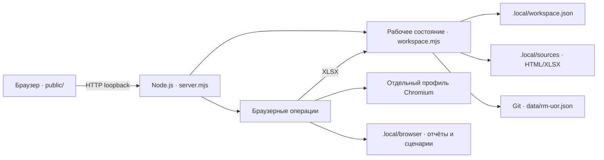
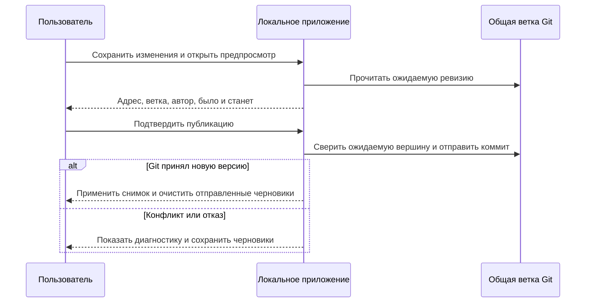

# SDD · Рабочее место УОР ДИТ OPS

Версия приложения 0.1.0. Базовая спецификация текущей реализации от 16 ноября 2026 года. Поведение сверено с исходным кодом. Этот документ описывает поставленную версию и служит исходной точкой для спецификаций изменений.

[Мастер-спецификация](MASTER_SPEC.md) задаёт требования продукта. SDD описывает действующее устройство приложения. Подробности и контроль покрытия ведутся в приложениях.

| Что искать | Документ |
| --- | --- |
| Все маршруты интерфейса, переходы и состояния | [Экраны и пути пользователя](sdd/screens.md) |
| Форматы, поля, источники и правила вывода | [Данные, идентификаторы и расчёты](sdd/data.md) |
| Все точки входа сервера и контракты операций | [Локальный HTTP](sdd/http.md) |
| Файлы приложения, тесты и приёмка | [Покрытие реализации](sdd/coverage.md) |
| Настройка, запись и перенос браузерных сценариев | [Браузерные подключения](browser-connectors.md) |
| Пилот версионных срезов и проект контракта Навигатора | [Паспорт Навигатора](sdd/navigator-integration.md) |
| Принятые и будущие этапы по последней встрече | [План от 16 ноября](plans/2026-11-16-dit-overview-and-reports.md) |

## 1. Назначение и границы

Приложение объединяет карту целей, план и факт из Excel, статусы на уровне ДИТ и ИТ-лидеров, отчёты кураторов и историю публикаций. Работа ведётся на отдельных компьютерах. Общие результаты передаются через репозиторий Git. Термины «руководитель», «ИТ-лидер» и «куратор» описывают сценарии работы. Разграничение прав на уровне локального интерфейса отсутствует. Права на чтение и запись общей версии определяет Git-сервер.

| Пользователь | Сценарий | Раздел |
| --- | --- | --- |
| Руководитель ДИТ | Выбирает период, смотрит картину по ДИТ, открывает список целей и исходный факт | Итоги → Карта целей, Статусы целей, Визуализация |
| ИТ-лидер | Смотрит назначенные ему цели, статусы, план, факт и строки Excel | Итоги → Карта целей, Статусы целей |
| Куратор | Загружает исходник, сверяет строки, настраивает расчёт и сохраняет черновик | Настройка → Источники, Сверка КР, Автоматизация, Цели и статусы |
| Редактор общего результата | Проверяет изменения, публикует выбранные цели или статусы ДИТ | Настройка → Цели и статусы, Статусы ДИТ |
| Сопровождающий | Настраивает подключение и сбор отчётов, проверяет журнал и выгружает копию | Настройка → Профиль и Git, Браузерные подключения |

## 2. Развёртывание

```text
npm run dev
```

Та же команда доступна как `npm start`. Обе запускают `node src/server.mjs` из корня. Требуется Node.js 20.19+. Базовые сценарии используют стандартные модули Node.js и браузер. Для общей публикации нужен Git в `PATH` или указанный абсолютный путь. Для сбора отчётов нужны Playwright и установленный браузер Chromium-семейства, допустимый политикой запуска. Тестирование корпоративного браузера, SSO и внутреннего репозитория проводится отдельно.

Сервер слушает `127.0.0.1:4179`. CLI читает `RM_UOR_PORT` и `RM_UOR_DATA_DIR`. По умолчанию используется `.local`. При первом запуске с путём по умолчанию `src/seed-workspace.mjs` восстанавливает комплект из `seed`, если рабочий `workspace.json` отсутствует. Файлы источников копируются с запретом перезаписи, затем состояние устанавливается атомарно через жёсткую ссылку на подготовленный файл в том же каталоге данных. Файловая система должна поддерживать эту операцию. Явно заданный `RM_UOR_DATA_DIR` запускает отдельное рабочее пространство без автоматического импорта комплекта. После запуска URL печатается в консоли.



Дополнительные параметры среды относятся к браузерной интеграции. `RM_UOR_PLAYWRIGHT` указывает абсолютный путь к установленному пакету, `RM_UOR_BROWSER` — к браузеру по умолчанию. В интерфейсе путь можно переопределить для подключения. Подробности в [инструкции подключения](browser-connectors.md).

## 3. Компоненты

| Компонент | Ответственность |
| --- | --- |
| `src/server.mjs`, `src/seed-workspace.mjs` | Запуск, установка стартового комплекта, статические ресурсы по разрешённому списку, маршруты JSON и оригиналов, ошибки, фоновое обновление Git |
| `src/workspace.mjs` | Каталог, справочник, источники, датировка и сверка КР, черновики, сохранение, предпросмотр и публикация |
| `src/imports.mjs` | Извлечение встроенных структурированных данных HTML и чтение XLSX как сохранённых значений |
| `src/status-register.mjs`, `src/status-goal-aliases.mjs` | Извлечение строк книги, распознавание периода и показателя, предложения по связи с целью |
| `src/status-snapshots.mjs` | Сравнение датированных срезов, различение рисков, отсутствующих и неоднозначных записей |
| `public/goal-status.js` | Общая проекция статусов и исходных значений для карты, реестра, визуализации и части недельного отчёта |
| `src/shared-git.mjs` | Работа штатным Git, чтение версии, создание коммита, защита ожидаемой ревизии, обработка отказов |
| `src/browser-connector.mjs`, `src/browser-recorder.mjs` | Изолированный профиль, ограничения адресов, запись кликов, воспроизведение действий, чтение текста и XLSX |
| `src/browser-workspace.mjs`, `src/browser-scenario.mjs` | Состояние подключений, очередь операций, локальное сохранение, проверка переносимого JSON-сценария |
| `src/weekly-curator-parser.mjs`, `src/weekly-curators.mjs` | Разбор отчётных недель, архив кураторских карточек и сводка |
| `src/visualization-config.mjs` | Валидация локального конструктора и порядка карточек |
| `public/app.js`, `public/*-view.js` | Навигация по хеш-маршрутам, фильтры, формы, предпросмотр, отображение результатов |

## 4. Данные и идентичность

| Сущность | Идентичность и хранение | Происхождение |
| --- | --- | --- |
| Источник | SHA-256 байтов, оригинал `.local/sources/<sha256>`, метаданные в `sources` | Импорт HTML или XLSX, XLSX из браузера |
| Каталог | Один активный `catalogSourceId`, цели по `goalId` | Последняя активированная HTML-карта. Повторный импорт архивной карты может снова сделать её активной |
| Назначение | `goalId` + `leaderId`. Для среза добавляется период | Назначения из карты и справочник. Сумма назначений может превышать число целей |
| Обычный результат | `goalId` + `scopeId` + `period`. План, значение, статус, комментарий, риск, дата факта, автор и дата записи | Локальный ручной ввод, принятый расчёт или Git |
| Статус и измерение ДИТ | `goalId` + `period`, общая ревизия записи | `ditDrafts` до отправки. Опубликованное значение в `shared.ditStatuses`. Статус и числовой факт можно сбросить независимо |
| Строка книги | Физический номер строки + период. Ключ сверки учитывает нормализованные поля КР, цели Excel и руководителя | Прочитанный XLSX. Отображаются источник, лист и строка |
| Дата среза | `sourceId` + подтверждённая дата, ревизия | Назначается в «Сверке КР». Незадатированная книга допускается для текущего просмотра |
| Визуализация | Упорядоченные карточки и ревизия настроек | Локальная настройка периода, фильтра, группировки и вида |
| Отчёт куратора | Подключение, куратор, адрес источника и понедельник отчётной недели | Видимый текст отчёта с явной датой или интервалом |

В `.local/workspace.json` хранится `schemaVersion: 1`. Основные поля включают `profile`, `catalog`, `catalogSourceId`, `goalEdits`, `directory`, `sources`, `statusDates`, `statusLinks`, `drafts`, `ditDrafts`, `automations`, `runs`, `visualization` и `shared`. Правки цели накладываются на карту. Замена карты меняет активный каталог и сохраняет оригиналы и ранее записанные правки. Старое состояние поддерживается через загрузочное преобразование каталога и ручных статусов ДИТ.

Изменения проходят через очередь локальных записей. JSON сохраняется через временный файл и замену основного. Проверки ревизии защищают смену настроек и изменения строк. Ограничение модели хранения — один пишущий процесс на каталог данных, состояние не рассчитано на конкурентную запись нескольких серверов в один файл. Резервная копия из `/api/backup` содержит состояние и оригиналы, закодированные в base64. Встроенного маршрута восстановления нет. Браузерное состояние хранится отдельно и в эту копию не входит.

## 5. Правила статусов и показателей

1. Карта определяет каталог, назначения и доступные уровни. КР из Excel сопоставляется с целью по явному коду или точному правилу формулировки в контексте. Связь с лидером требует однозначного совпадения с назначением. Подтверждённые связи имеют приоритет. Неоднозначные записи остаются на сверке. Книга может содержать строки вне карты.
2. Если книга выбрана явно, используется она. Если есть подтверждённые даты, берётся последний срез. При совпадающих датах нужен явный выбор. При отсутствии дат пробуются книги в порядке от новых к старым. Для сравнения недельных рисков требуются датированные срезы и общий период.
3. Прогресс из Excel, факт, план и прогноз хранятся отдельными полями. Парсер использует сохранённые значения ячеек. Факт `80` и относительный прогресс к плану `0,8` имеют разную семантику. Таблица статусов показывает план и факт исходных строк. Несколько КР отображаются отдельными значениями в карточке.
4. Проекция назначения исключает `monitor`, `removed`, `outOfScope` и неактивные назначения. Периоды берутся из книги. Единственное предварительное совпадение допустимо с указанием происхождения. Если есть несколько подтверждённых КР, явный риск имеет приоритет. Выполнение требует выполнения всех связанных КР. Незаполненные статусы сохраняются отдельным состоянием.
5. На уровне ДИТ одна строка на цель и период. Ручной статус имеет приоритет, далее используется статус явной итоговой строки Excel. Если оба отсутствуют, цель ДИТ остаётся без статуса. Статусы лидеров относятся к их назначениям. Факт и план из сохранённого измерения ДИТ имеют приоритет в проекции чисел. При отсутствии измерения факт берётся из единственной итоговой строки Excel, а план может дополнительно поступить из согласованного плана лидеров или карты. Показатели лидеров доступны как исходные данные в деталях.
6. Сводки показывают распределение по уникальным целям ДИТ и результаты каждого лидера. Графики по нескольким лидерам группируются по лидеру. Кнопка риска открывает реестр с периодом и уровнем выбранной сводки.
7. Локальный автоматический расчёт использует заранее выбранные источник, лист и столбцы участника и значения. Сохраняет результат прогона. Действие «Принять расчёт» явно переносит его в черновики. Текущая автоматизация переносит и нормализует сохранённые значения выбранной книги. Версионный движок произвольных формул, объединения нескольких файлов и подтверждённых методик отдельных целей не поставлен.
8. Технический пилот среза ДИТ поддерживает сохранение ручного значения с основанием, чтение явного итогового значения и расчёт доли по двум числовым ячейкам. Измерение открывается в карточке цели и в «Итоги → Срезы ДИТ», доступно для выгрузки JSON и публикации вместе со статусом через Git. [Формат и приоритеты](sdd/data.md#измерение-дит-и-выгрузка-среза).

## 6. Еженедельный отчёт и браузер

Сводка кураторов строится по сохранённым блокам страниц. Парсер ищет явные даты или отчётные интервалы и отдельно извлекает достижения, внимание, планы и инсайты. Неделя индексируется понедельником той календарной недели, в которую попадает конец интервала. Показывается до трёх пунктов на раздел. Общая карточка отбирает записи по порядку приоритета в карточках кураторов и убирает одинаковые формулировки. Отсутствие записей показывается явно. Сравнение рисков из Excel доступно в отдельном раскрывающемся блоке и использует свои даты срезов.

Подключение содержит URL, разрешённые адреса, селекторы и шаги сценария. Пользователь входит в отдельно открытом браузере. Чтение и скачивание могут использовать эту же вкладку. XLSX проходит проверку формата и добавляется к обычным источникам. Для текста сохраняется результат выбранного блока. Локальный архив недель сохраняет прошлые недели при новом чтении. Запись кликов использует вкладку отчёта и доверенные действия на основном фрейме. Переносимый JSON версии 1 содержит клики, ожидания и необязательный селектор скачивания. Адреса, профиль браузера, учётные данные и значения полей остаются за пределами переносимого сценария.

| Ограничение | Значение |
| --- | --- |
| Источник или скачанный XLSX | До 20 МиБ |
| Настроенные браузерные подключения | До 16 |
| Одновременно занятые профили | До 4 |
| Хранимые состояния браузерных заданий | До 64 |
| Снимок браузерного состояния | До 8 МиБ |
| Текст блока отчёта | До 100 000 символов |
| Переносимый сценарий | До 12 шагов и 16 КиБ |

## 7. Общая версия через Git



Git хранит `data/rm-uor.json` с `version`, `goals`, `history` и необязательным `ditStatuses` для совместимости со старыми версиями. Публикация обычных результатов выбирает цели. Публикация ДИТ выбирает правки периода. Проверяется точный предпросмотр, ревизия Git и база каждой меняющейся записи. Историю можно читать отдельным экраном. При откате или несовместимом снимке сохраняется последняя успешная версия. Код программы доставляется отдельно от рабочего обмена данными.

Измерения ДИТ публикуются в том же коммите в `data/rm-uor-dit-measurements.json`. Раздельные файлы позволяют старым установкам публиковать статусы и сохранять измерения в дереве Git. Новая установка объединяет файлы одного коммита. [Схемы данных](sdd/data.md#общий-git-файл-и-копия).

В системном режиме Git использует настройки установленного клиента. Это позволяет фоновую проверку с заданным интервалом. В режиме запроса пароля пользователь запускает чтение и отправку явно. Разовый логин и пароль привязываются к HTTPS-адресу операции, передаются Git через окружение дочернего процесса и не записываются в профиль. На пути с ручным входом проверяются перенаправления и ожидаемая ревизия. ФИО профиля используется для подписи изменений. Учётная запись и права зависят от Git-сервера. Маршрут проверки исполняемого файла проверяет `git --version`. Право на запись определяется при публикации.

## 8. HTTP-контракты и защита локального сервера

[Полный контракт локального HTTP](sdd/http.md) содержит методы чтения, все записи, тела запросов, коды и версионные поля. Ниже приведена карта групп API.

| HTTP | Назначение |
| --- | --- |
| `GET /api/state` | Проекция рабочего состояния, каталога, черновиков и общей истории |
| `POST /api/source` | Импорт оригинала. Имя передаётся в `x-file-name` |
| `GET /api/source/<sha>/preview` и `/file` | Табличный просмотр и загрузка исходника |
| `GET /api/status-register` | Строки выбранной книги, периоды, связи и происхождение |
| `GET /api/status-week` | Сравнение датированных срезов или текущий срез, возможна фильтрация по карте |
| `POST /api/snapshot`, `/api/statuslink`, `/api/status`, `/api/dit-status` | Датировка среза, подтверждение связи и редактирование результатов |
| `POST /api/automation`, `/api/calculate`, `/api/accept` | Настройка, запуск и принятие табличного расчёта |
| `POST /api/refresh`, `/api/publishpreview`, `/api/publish`, `/api/gitcheck` | Чтение Git, предпросмотр, подтверждённая публикация и проверка доступности Git |
| `GET /api/browser`, `POST /api/browser/<operation>` | Состояние подключений, работа с окном, сбор, запись и перенос сценария |
| `GET /api/curator-week` | Агрегат заданной недели и карточки кураторов |
| `GET /api/backup` | Экспорт локального состояния с оригиналами |

HTTP ограничивает `Host` значениями localhost и loopback с фактическим портом. Записи требуют `x-rmuor: 1` и при наличии проверяют `Origin`. Статические файлы перечислены явно. HTML-источник анализируется как данные, его скрипты не исполняются. Рабочая папка напрямую не раздаётся. Для браузерных операций проверяются разрешённые адреса и TLS. Модель запуска рассчитана на доверенную локальную сессию пользователя. Для общего сетевого хостинга нужна отдельная модель доступа и изоляции.

## 9. Проверки и ограничения текущей версии

Перечень модулей, тестовых файлов и сценариев приёмки ведётся в [матрице покрытия](sdd/coverage.md).

| Область | Что проверять |
| --- | --- |
| Запуск | Чистая копия с `seed` открывает карту и Excel. Повторный запуск сохраняет рабочие правки. Пользовательский путь данных и другой порт работают отдельно |
| Импорт и статусы | Оригинал совпадает с SHA-256, смена карты ограничивает каталог, несовместимая книга диагностируется, периоды не смешиваются |
| Управленческие цифры | Сравниваются количество целей и количество назначений, не теряется состояние «Нет статуса», значения доступны до исходной строки |
| Публикация | Две установки видят один результат после обновления, пустой ручной статус снимает переопределение, конфликт сохраняет черновики |
| Браузер и отчёты | Локальная страница проходит запись и скачивание, форма входа исключается из записи, даты и пустые недели воспроизводятся |

`npm test` запускает проверки импорта, проекций, Git, недельного парсера, браузерных операций и хранения. Сценарии с реальным браузером и приложенной рабочей книгой выбираются через переменные, используемые в соответствующих тестах. Для совместимости платформ и корпоративных подключений нужна приёмка на целевых устройствах.

В текущем коде `workspace.mjs` и `app.js` координируют несколько областей. Для дальнейшей разработки важно выделить спецификации результата и его происхождения, рисков на разных уровнях, версий расчётов и обмена независимыми отчётами. Каждое изменение стоит проверять по входному примеру, ожидаемому выходу и пользовательскому пути прежде, чем менять действующий срез данных.
