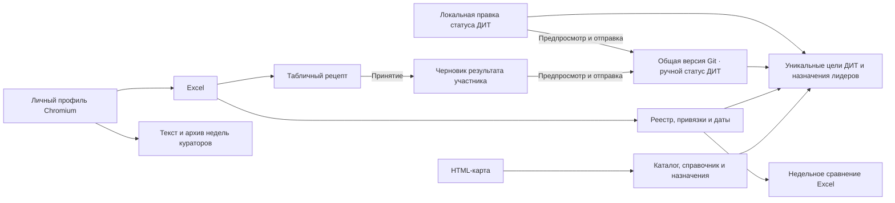

# Архитектура рабочего места УОР

[SDD](SDD.md) описывает текущую архитектуру. [Мастер-спецификация](MASTER_SPEC.md) фиксирует требования продукта. [Матрица покрытия](sdd/coverage.md) связывает исходники и тесты с разделами.

Основа проекта — расшифровка от 12 ноября 2026 года. На 03:53–05:54 обсуждаются карта и справочники, на 06:41–15:30 общий репозиторий, на 16:57–25:41 исходники и автоматизация, на 29:18–31:40 публикация, на 33:11–34:38 отдельные страницы отчёта и визуализации. Порядок работ после следующей встречи зафиксирован в [плане от 16 ноября](plans/2026-11-16-dit-overview-and-reports.md).

Классы данных, форматы файлов и приоритеты описаны в [приложении по данным](sdd/data.md). Ветка Git хранит общий срез, локальный сервер обслуживает интерфейс, а Chromium использует отдельное личное рабочее пространство. Для сетевого многопользовательского развёртывания потребуется отдельная архитектура доступа.
