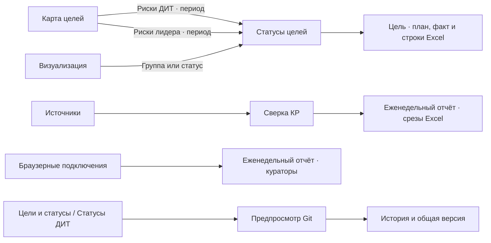

# Экраны и пути пользователя

[SDD](../SDD.md) · [Мастер-спецификация](../MASTER_SPEC.md) · [Данные](data.md)

## Навигация

`index.html` задаёт оболочку, сайдбар, область контента и диалог. `app.js` переключает страницы по хешу и хранит фильтры текущего сеанса. «Итоги» и «Настройка» раскрываются в боковом меню. Прямой вход по хешу выбирает экран. Стартовый экран — «Карта целей». Действия в «Итогах» в основном относятся к выбору представления, открытию деталей и чтению данных. Правки и публикация вынесены в «Настройку».

| Раздел и маршрут | Сценарий, действия и пустое состояние |
| --- | --- |
| Итоги · `#map` | Сводка числа выполненных целей из общего числа и риска по ДИТ и лидерам. Период, поиск и карточки карты. Клик «Под риском» открывает реестр нужного разреза. Карточка показывает назначение, методику, артефакты и результаты |
| Итоги · `#statuses` | Реестр целей ДИТ или назначений лидеров. Фильтры книги, периода, статуса, лидера и поиска. План, факт и источник доступны на строке или в деталях. Нулевое число совпадений отображается пустой выборкой |
| Итоги · `#dit-reports` | История и сравнение точных дат в выбранном периоде. Ниже текущие измерения, происхождение и выгрузка JSON |
| Итоги · `#risk-actions` | Локальные поручения, статусы, исполнитель, срок, просрочка и изменение задачи. Создание доступно у строки риска |
| Итоги · `#weekly` | В оперативном режиме неделя, карточки и сводка кураторов, срезы Excel, риски, сравнение и поручения. В режиме «К встрече» — конструктор, предпросмотр и редактируемый PowerPoint для всего ДИТ или лидера |
| Итоги · `#browser-reports` | Последний успешный текст каждого подключения с источником и временем. При сбое новый результат не вытесняет предыдущий |
| Итоги · `#visualization` | Сводка ДИТ и карточки графиков. Период, статус и лидер определяют набор. Группа ведёт в реестр с фильтрами. Пустая компоновка имеет собственное состояние |
| Итоги · `#history` | История просмотренной Git-версии, время и диагностический результат проверки, ручное обновление |
| Настройка · `#edit` | Правка каталожных полей цели, ручные результаты участников, предпросмотр и отправка выбранных целей |
| Настройка · `#dit-settings` | Выбор периода, таблица статусов ДИТ, независимый ввод или расчёт факта, раздельный сброс статуса и факта, предпросмотр и отправка изменений периода |
| Настройка · `#sources` | Загрузка HTML/XLSX, отметка активного каталога, просмотр листа XLSX и скачивание оригиналов |
| Настройка · `#connectors` | Создание и правка подключения, вход в окно, запись кликов, загрузка/выгрузка сценария, получение XLSX, чтение текста, закрытие окна и журнал |
| Настройка · `#reconcile` | Книга, дата среза, поиск и проверка исходных строк, подтверждение или снятие связи с целью и лидером |
| Настройка · `#directory` | Участники и их алиасы. Создание или обновление записи и связи с лидером |
| Настройка · `#automation` | Рецепт для выбранной цели, проверка диапазона, запуск расчёта, просмотр и принятие в локальные результаты |
| Настройка · `#quality-pilot` | Сопоставление колонок, расчёт по SW26.3, отклонения отдельных команд, просмотр и экспорт сохранённых срезов |
| Настройка · `#visualization-builder` | Создание, редактирование, порядок и удаление карточек, выбор вида, группы, периода и фильтров |
| Настройка · `#settings` | ФИО, Git-адрес, ветка, интервал, способ входа и путь к Git, проверка Git, палитра и скачивание резервной копии |

## Переходы и отображение

В карте один счётчик относится к уникальным целям ДИТ, остальные показывают назначения каждого лидера. Общего числа назначений в руководительской сводке нет. При переходе с риска ДИТ выбирается фильтр ДИТ, с риска кластера — конкретный лидер. Отсутствующий факт обозначается прочерком. Нулевой факт отображается числом, если он есть в источнике.

Палитры `system`, `indigo`, `slate`, `sand`, `forest` и `dark` применяются ко всему приложению и сохраняются в локальном профиле. Системная тема использует настройку браузера/ОС. Стили включают узкие экраны и крупные цели для сенсорных устройств. Статусы сопровождаются текстом. При отказе операции сообщение доступно в диалоге или области уведомлений. Проверка скринридеров и полная проверка навигации с клавиатуры на целевых устройствах остаются отдельной приёмкой.
